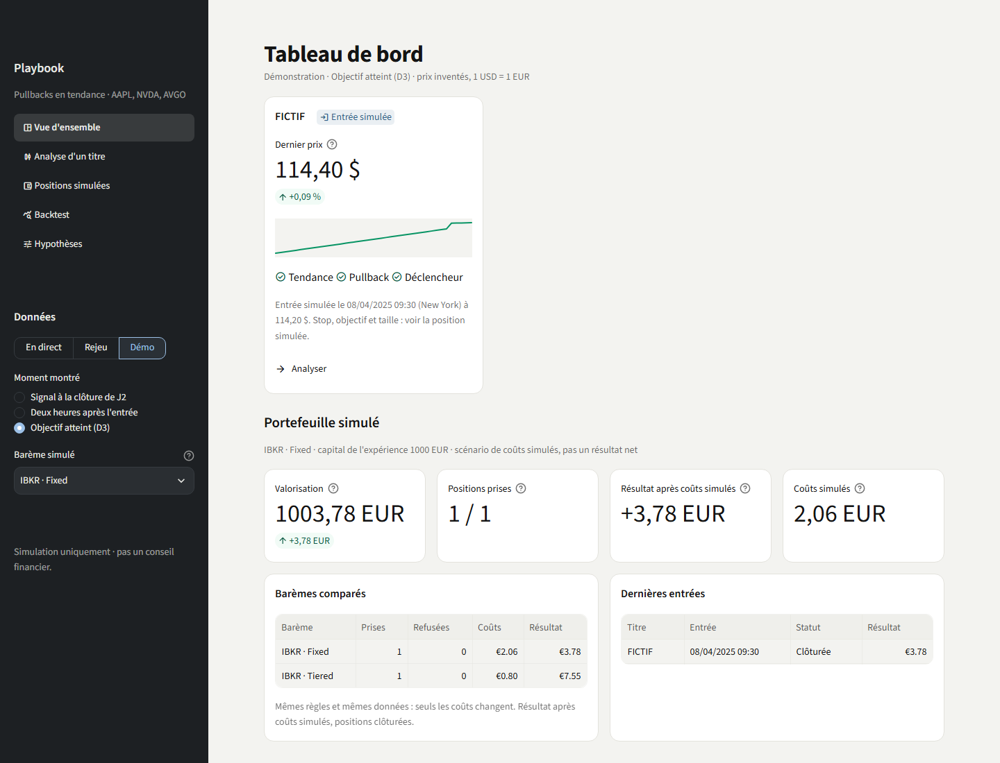
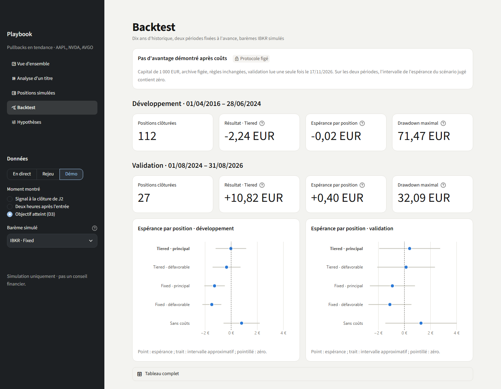
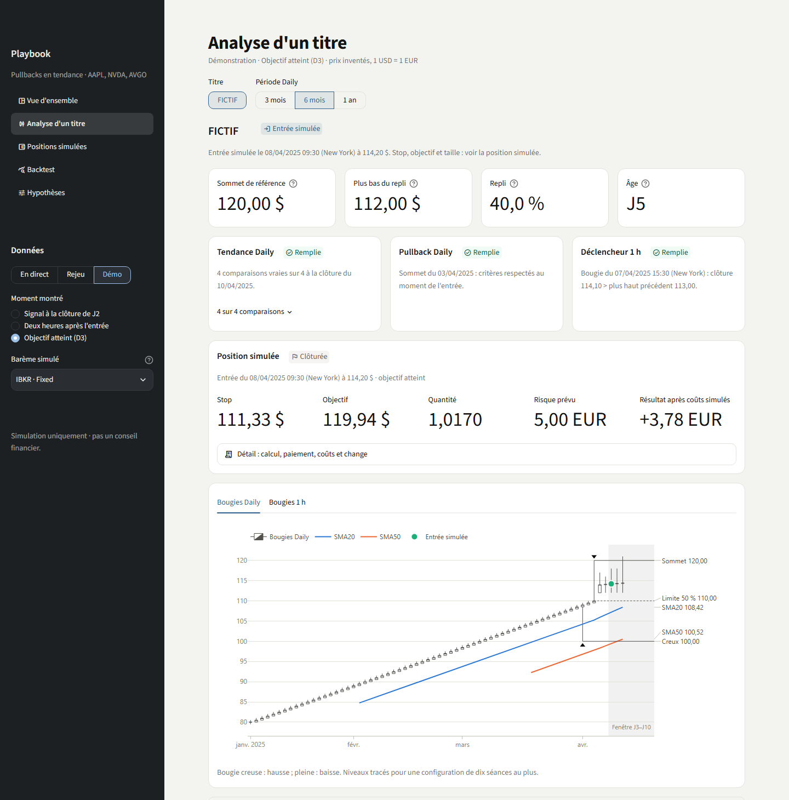

# financial-market-dashboard

Un outil de **swing trading simulé** sur AAPL, NVDA et AVGO : il dit, avec des cours à jour, si les règles d'une stratégie de pullback en tendance sont remplies, simule les positions qui en découlent avec des coûts de courtier réalistes, et mesure honnêtement ce que la stratégie aurait rapporté sur dix ans d'historique.

> **Simulation uniquement.** Ce projet ne passe aucun ordre et ne se connecte à aucun compte de courtier. « Conditions remplies » décrit les règles d'une stratégie : ce n'est pas un conseil d'achat. Rien ici n'est un conseil financier.



*Le tableau de bord en mode démonstration : tous les prix sont inventés.*

## Ce que fait le projet

La stratégie suit quatre étapes, chacune écrite dans une spécification avant d'être codée :

| Étape | Règle | Spécification |
| --- | --- | --- |
| 1. Tendance Daily | Clôture au-dessus de la SMA50, SMA20 au-dessus de la SMA50, les deux en hausse sur cinq séances | [GUIDE.md](GUIDE.md) |
| 2. Pullback Daily | Repli d'au plus 50 % de la dernière hausse, entrée autorisée de la 3e à la 10e séance après le sommet | [SPEC_PULLBACK.md](SPEC_PULLBACK.md) |
| 3. Déclencheur 1 h | Une bougie horaire clôture au-dessus du plus haut de la précédente ; entrée à l'ouverture suivante | [SPEC_ENTREE_1H.md](SPEC_ENTREE_1H.md) |
| 4. Sorties et risque | Stop sous le plus bas du repli (marge de 0,25 ATR14), objectif à 2 fois le risque, sortie au plus tard à la 10e séance ; 0,5 % du capital risqué par position | [SPEC_SORTIES_RISQUE.md](SPEC_SORTIES_RISQUE.md) |

Autour de ces règles :

- **un tableau de bord** ([Streamlit](https://streamlit.io/)) en cinq sections : vue d'ensemble des trois titres, analyse d'un titre (conditions, niveaux, position simulée, graphiques Daily et horaires), positions et liquidités, résultats du backtest, hypothèses ;
- **un moteur de simulation** qui tient un compte au comptant en EUR et en USD : commissions Interactive Brokers (barèmes « Fixed » et « Tiered »), conversion automatique EUR/USD, délai de règlement des ventes, glissement ;
- **un backtest** sur une archive figée de dix ans, avec une période de validation lue une seule fois.

## Résultats du backtest

Capital de départ : 1 000 EUR. Les périodes, les coûts et les critères de lecture ont été fixés **avant** de regarder les résultats ; aucune règle n'a été ajustée ensuite.

| | Développement<br>01/04/2016 – 28/06/2024 | Validation<br>01/08/2024 – 31/08/2026 |
| --- | ---: | ---: |
| Positions clôturées | 112 | 27 |
| **Barème « Tiered », exécution principale** | **−2,24 EUR** (−0,02 EUR par position) | **+10,82 EUR** (+0,40 EUR par position) |
| Intervalle approximatif de l'espérance par position | −1,19 à +1,15 EUR | −1,94 à +2,74 EUR |
| Barème « Fixed », exécution principale | −142,01 EUR | −24,72 EUR |
| Sans aucun coût (théorique) | +91,71 EUR | +34,41 EUR |

**Conclusion : pas d'avantage démontré après coûts.** Les deux périodes concordent. Avant frais, les règles captent un léger mouvement favorable, compatible avec le hasard. Avec 1 000 EUR, le minimum de commission par ordre pèse lourd face à un risque d'environ 5 EUR par position : avec le barème « Tiered », les frais absorbent l'essentiel du gain ; avec « Fixed », ils le dépassent.



Ce résultat négatif est le principal enseignement du projet : une stratégie qui paraît raisonnable sur un graphique ne survit pas forcément aux coûts réels. Le détail et le protocole complet sont dans [SPEC_SORTIES_RISQUE.md](SPEC_SORTIES_RISQUE.md), section 15.



## Points de méthode

- **Aucune information du futur.** Chaque décision n'utilise que ce qui était connu à son instant : bougies terminées, taux de change déjà publiés, retard imposé par la source de données. Des tests le vérifient.
- **Divisions d'actions traitées exactement.** Les signaux utilisent des cours continus, sans arrondi ; chaque position est calculée en cours réels de son époque (pas de prix, quantité, commissions).
- **Compte au comptant réaliste.** Les USD d'une vente ne sont utilisables qu'après règlement ; un achat ne convertit que les USD qui manquent ; un achat non finançable est refusé avec son motif.
- **Rien n'est retiré des comptes.** Les entrées refusées, ambiguës ou non évaluables gardent leur ligne et leur motif.
- **Archive figée.** Les données du backtest sont téléchargées une fois ; une empreinte refuse toute archive modifiée.

## Installer et lancer

Testé sous Windows 11 avec Python 3.14 (Python 3.11 au minimum).

Télécharge le dépôt (bouton « Code » puis « Download ZIP » sur GitHub, ou `git clone`), puis, dans PowerShell, depuis le dossier du projet :

```powershell
py -3.14 -m venv .venv
.\.venv\Scripts\python.exe -m pip install -r .\requirements.txt

# Vérifier l'installation : la suite de tests tourne sans réseau ni clé.
.\.venv\Scripts\python.exe -m unittest discover
```

**Tableau de bord en démonstration** (prix fictifs, sans réseau ni clé) :

```powershell
.\.venv\Scripts\python.exe -m streamlit run .\tableau_de_bord.py
```

puis ouvre `http://127.0.0.1:8501/?mode=demo` dans le navigateur. On peut ouvrir directement une section : `?mode=demo&section=analyse` (ou `accueil`, `positions`, `backtest`, `hypotheses`). Sous Windows, `ouvrir_tableau_de_bord.bat` lance aussi la page.

**Données réelles.** Les cours viennent de l'API gratuite d'[Alpaca Market Data](https://alpaca.markets/). Crée un compte « Paper » (simulation), génère tes clés, puis enregistre-les comme variables d'environnement, jamais dans un fichier du projet :

```powershell
setx APCA_API_KEY_ID "ta_cle"
setx APCA_API_SECRET_KEY "ton_secret"
```

Ferme et rouvre le terminal. Le mode « En direct » du tableau de bord fonctionne alors, ainsi que les programmes ci-dessous :

```powershell
# État du jour des trois titres, dans le terminal.
.\.venv\Scripts\python.exe .\etat_du_jour.py

# Positions simulées sur les 45 derniers jours, barèmes « Fixed » et « Tiered ».
.\.venv\Scripts\python.exe .\etape_04_sorties_risque.py --symbole AAPL --symbole NVDA --symbole AVGO

# Backtest : figer l'archive (une fois), puis mesurer la période de développement.
.\.venv\Scripts\python.exe .\historique.py
.\.venv\Scripts\python.exe .\backtest.py --periode developpement
```

Le capital simulé et les scénarios de coûts sont lus dans `configuration_exemple.toml`. Pour décrire ton propre compte, copie ce fichier sous le nom `configuration_locale.toml` : il est exclu de Git.

## Organisation du dépôt

| Fichier | Rôle |
| --- | --- |
| `etape_01_tendance.py` … `etape_04_sorties_risque.py` | Les quatre étapes de la stratégie |
| `source_alpaca.py`, `source_bce.py` | Téléchargement des cours (Alpaca) et des taux EUR/USD (Banque centrale européenne) |
| `etat_du_jour.py`, `graphiques.py`, `tableau_de_bord.py`, `apparence.py` | Résumé du jour, graphiques, page Streamlit et logo animé facultatif (`personnalisation/logo_anime.png`, non publié) |
| `historique.py`, `backtest.py`, `inventaire_donnees.py` | Archive figée, backtest et inventaire des données |
| `configuration.py`, `configuration_exemple.toml` | Capital simulé et scénarios de coûts |
| `test_*.py` | 367 tests, sans réseau |
| `docs/images/` | Captures du tableau de bord en démonstration |
| `SPEC_*.md` | Règles validées, conventions et protocole |
| [GUIDE.md](GUIDE.md) | Construction du projet pas à pas, avec les notions Python |

## Données

Aucune donnée de marché n'est publiée dans ce dépôt : chaque utilisateur télécharge les siennes avec ses propres clés, dans le respect des conditions d'utilisation de chaque source (Alpaca, Banque centrale européenne, Yahoo Finance pour la comparaison). Les taux de la BCE sont publiés à titre d'information ; ils servent ici à valoriser la simulation, pas à prédire le taux d'un courtier.

## Licence

[MIT](LICENSE).
